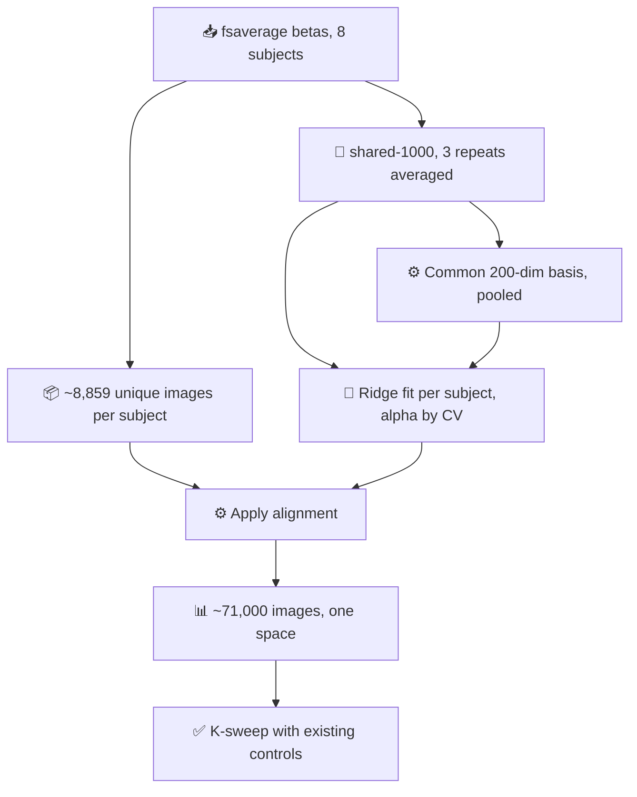

# Effective Dimensionality of Synthetic and Real fMRI Targets

_Why BERG-generated responses cannot support role discovery, and a ridge-alignment
pipeline for pooling NSD subjects instead_

---

Synthetic fMRI from BERG carries an effective dimensionality of **3.2**. Real NSD
betas from the same subject, with a matched number of units, carry **141**. If
role–filler binding manifests as elevated dimensionality, the synthetic data
cannot contain the phenomenon this project set out to discover — at any sample
size.

## 📊 The measurement

Participation ratio, $D = \left(\sum_i \lambda_i\right)^2 / \sum_i \lambda_i^2$,
the same statistic Desbordes et al. use for intrinsic dimensionality.[^1]

| Source | Participation ratio | PC1 share | Units | Samples |
| --- | --- | --- | --- | --- |
| BERG synthetic, subj01 ventral | **3.2** | 48.4% | 7,604 voxels | 49,218 images |
| Real NSD, subj01 session01 | **141.1** | 3.5% | 7,604 vertices | 750 trials |
| i.i.d. Gaussian reference | 681.6 | — | 7,604 | 750 |

Both matrices were built to be comparable at 7,604 units, the voxel count of
BERG's subject-1 ventral ROI. The comparison is conservative in the synthetic
data's favour: it had 49,218 images in which to express dimensionality against
750 trials for the real betas, so it had far more room and still returned 3.2.

The gap opens at the first component and never closes:

| Cumulative variance | BERG synthetic | Real NSD |
| --- | --- | --- |
| 50% | 1 PC | 62 PCs |
| 80% | 3 PCs | 213 PCs |
| 95% | 11 PCs | 450 PCs |
| 99% | 51 PCs | — |

Real betas sit well below the i.i.d. noise ceiling of 681.6, so 141 reflects
structure rather than noise alone. It is nonetheless noise-inflated; see
[Caveats](#-caveats-and-open-questions).

## 🔬 Why BERG is low-rank

This is architectural, not a defect in the generation pipeline. The fwRF encoder
is a shared feature backbone with per-voxel linear readouts, so every one of the
7,604 predicted voxels is a linear function of one modest feature space and
predicted responses are confined to a low-rank subspace by construction. The
model is also deterministic: no trial noise, no voxel-specific idiosyncrasy.

Verified from the released checkpoint rather than inferred:

| Property | Value |
| --- | --- |
| Training subjects | `subjects = single`, `used_nsd_subj = 1` |
| Training images | 9,000 (+485 validation, +515 test) |
| Median voxel $r^2$ | 0.021 (mean 0.065) |
| Median noise ceiling | 0.089 (mean 0.153) |
| Fraction of ceiling reached | 31–36% |
| Voxels with $r^2 > 0.1$ | 24.7% of 7,604 |

> **Correction to an earlier assumption.** The released weights were trained on
> subject 1 alone, not pooled across subjects. The `shared_model` /
> `subject_fwrfs` structure supports joint training and the creation code exposes
> `--subjects all`, but the shipped checkpoint records `subjects = single` with a
> one-entry `fwrfs` dict. The genuinely leaked image set is therefore **10,000**,
> not the 73,000 excluded when building `berg_synth/manifest.json`. The exclusion
> was harmless; its stated rationale was wrong.

## 🎯 Why it matters for role discovery

Desbordes et al. share this project's framework rather than merely neighbouring
it: their Figure 1 is $\text{Agent}\otimes\text{Friend} \oplus
\text{Complement}\otimes\text{Bill} \oplus \text{Verb}\otimes\text{Eat}$, citing
Smolensky, and their central hypothesis is that summing filler–role bindings
**increases intrinsic dimensionality**, because across varied fillers the bound
vectors point in varied directions and span a larger space.[^1] Elmoznino and
Bonner point the same way from the model side: encoding performance rises with
latent dimensionality across 568 DNN layers, in both monkey electrophysiology and
human fMRI.[^2]

If binding manifests *as* high dimensionality, a generator with PR 3.2 cannot
exhibit the signature.

The K-sweep run on the synthetic targets corroborates this independently. Across
three PC counts, the size of the $K=8$ advantage moves *inversely* to the
stability of the roles it finds:

| Target | $q$ params per constraint | Gain over $K=1$ | Images improved | A/B agreement (chance 0.125) |
| --- | --- | --- | --- | --- |
| PCA-3 | 12.6 | +16.9% | 59.7% | 0.176 |
| PCA-8 | 6.3 | +15.4% | 65.5% | 0.257 |
| PCA-50 | 1.01 | +6.9% | 78.1% | 0.339 |

Every column is monotone in the constraint ratio. The looser the posterior, the
more it improves MSE and the less its assignments replicate across the two
inference halves — the signature of a posterior absorbing target values rather
than recovering a stable role vocabulary. A swap control confirmed $q$ is
image-specific (a mismatched posterior scores worse than switching the
interaction off entirely), which rules out generic readout capacity but does not
separate absorption from binding.

**Practical consequence:** `improvement_over_k1` is not a safe model-selection
criterion. It systematically rewards the configurations in which roles are least
trustworthy. Rank on A/B agreement instead.

## 🔄 Proposed pipeline: ridge alignment across subjects

BERG was adopted because a single NSD subject looked too thin to train ROLE-class
architectures. That concern was reasonable — one subject gives 10.9 observations
per interaction parameter, and with a median voxel noise ceiling of 0.089 the
reliable count is far lower. But the synthetic route traded a sample-size problem
for a rank problem, and the rank problem is worse: no quantity of low-rank
samples recovers directions that are not there.

Ferrante et al. validate a route to the data volume without the rank collapse —
ridge regression as a cross-subject functional aligner, tested on NSD itself,
outperforming both hyperalignment and anatomical alignment.[^3] Their formulation
maps source voxels to target voxels with a square $W$ ($\alpha = 1000$, fit on
952 shared images). The adaptation below regresses onto a shared *reduced* basis
instead, which is far better conditioned and loses nothing: a ridge map fit on
~1,000 images has rank at most ~1,000 regardless of voxel count.

1. **Build targets from real betas in fsaverage.** Surface space already supplies
   anatomical correspondence. Ferrante et al. show anatomical alignment alone
   performs barely above chance, so it is a starting point, not the method. All
   eight subjects' `nsd_fsaverage_betas` are on disk.
2. **Average the three repeats of the shared-1000.** Alignment quality is
   SNR-limited and this costs nothing. These ~1,000 images, seen by every
   subject, are the anchor set.
3. **Define one common 200-dimensional basis** fit on pooled shared-image
   responses, not on any single subject. Ferrante et al. target Subj01 only
   because their decoder was trained there; a symmetric template avoids
   inheriting one subject's idiosyncrasies. 200 is matched to the measured PR of
   ~141, so little is truncated.
4. **Ridge each subject's voxels into that basis**, fit on the shared-1000 only,
   with $\alpha$ selected by cross-validation over the anchor set. The alignment
   and the role model must never see the same images.
5. **Pool the per-subject unique images.** ~8,859 per subject across 8 subjects
   gives roughly 71,000 images in one coordinate system — about 80 observations
   per interaction parameter, against 10.9 for one subject.
6. **Re-run the K-sweep with the existing controls.** The paired test, swap
   control, uniform-$q$ control and A/B agreement in `analyze_role_controls.py`
   transfer unchanged.

**Cheapest next step.** Before building any of this, align *two* subjects on the
shared-1000 and test whether a $K=1$ filler model trained on subject A's unique
images predicts subject B's aligned responses above chance. That validates
end-to-end that the aligned space preserves what the model needs, at a small
fraction of the cost.

## 🧪 Pilot result: two-subject alignment on a simulated shared 1000

[`align_subjects.py`](align_subjects.py) runs the cheapest version of the
pipeline above. Subject 2's ventral responses (8,185 voxels, a genuinely
different voxel space from subject 1's 7,604) were generated for the same 49,218
images, a ridge map $W: B \to A$ was fit on nested subsets of subject 1's own
training split, and the **K=1 filler model already trained on subject 1** was
scored on the aligned responses for the untouched 7,384 test images.

K=1 is the right probe because with one role the centered TPR is identically
zero, so the model collapses to $\hat{y} = b + B\sum_j f_j$ — a stimulus-only
map that never reads the target. The script asserts this rather than assuming
it: randomizing the target must not move the prediction by more than $10^{-5}$,
and the replayed within-subject $R^2$ must reproduce `test_metrics.json` exactly.
Both hold.

| $n_\text{align}$ | voxel $r$ (test) | aligned-target $R^2$ | model $r$ on aligned B | vs within-subject |
| ---: | ---: | ---: | ---: | ---: |
| 100 | 0.861 | 0.652 | 0.492 | 105.8% |
| 250 | 0.892 | 0.707 | 0.497 | 106.9% |
| 500 | 0.907 | 0.738 | 0.495 | 106.4% |
| **1000** | **0.916** | **0.755** | **0.493** | **106.0%** |
| 2000 | 0.923 | 0.768 | 0.493 | 106.0% |
| 8000 | 0.935 | 0.789 | 0.486 | 104.5% |

PCA-8 targets; within-subject reference $r = 0.465$, $R^2 = 0.238$. Permuting the
image pairing inside the alignment set drives voxel $r$ and model $r$ to zero in
every row, so the correspondence — not the shrinkage — is what carries the
result.

### Read the correlation, not the $R^2$

Model $R^2$ on the aligned target is 0.257 against a within-subject 0.238, which
looks like subject B is *easier* to predict than subject A. It is not. Ridge
shrinks the aligned target to 0.763× subject A's variance, and what shrinkage
removes first is the idiosyncratic high-variance component that the filler model
was never going to predict. $R^2$ rewards that; correlation, being
scale-invariant, does not, which is why both are reported.

### The alignment is easy here for a reason that will not hold on real data

One hundred paired images already reach $r = 0.861$, and eighty times more data
buys 0.074. That is what a participation ratio of **3.2** (subject 1) and
**3.1** (subject 2) looks like: there is almost no subspace to estimate. Real
NSD subject 1 sits at **141.1**. The transfer succeeding is therefore a
measurement of BERG's shared backbone, not evidence that a shared-1000 ridge
will carry real betas.

The backbone does not make the map exactly linear, though — voxel $r$ asymptotes
at 0.935, not 1.0, because each voxel's fwRF applies its own spatial pooling to
the shared feature maps, so no single linear map relates the two voxel sets. In
a top-50 PC subspace over 20,000 images, 13 canonical directions exceed $r=0.9$
and 35 exceed $r=0.5$: strongly, not perfectly, shared.

### The one number that does transfer

Alignment fidelity in **target** space degrades sharply with the number of PCs
being aligned, at fixed shared-image budget:

| PCs | aligned-target $R^2$ at $n=100$ | at $n=1000$ | at $n=8000$ |
| ---: | ---: | ---: | ---: |
| 3 | 0.879 | 0.914 | — |
| 8 | 0.652 | 0.755 | 0.789 |
| 50 | 0.257 | 0.604 | — |

At 3 PCs a hundred images suffice. At 50 PCs a thousand images recover 60% of
the target and the curve is still climbing. Since the pipeline above exists in
order to deliver 100–300 PCs, **the shared-1000 budget is the binding
constraint on that plan**, and this holds independently of the low-rank
artefact — it is a statement about estimating a $p \times p$ map from $n$ pairs,
and the real data has strictly more structure to estimate, not less.

## 🧠 The same test on real NSD betas

[`align_subjects_nsd.py`](align_subjects_nsd.py) repeats the pilot on real
data: subjects 1 and 2, `streams` ventral on fsaverage, betas z-scored within
session and averaged over the three presentations
([`nsd_real_betas.py`](nsd_real_betas.py)), restricted to the 7,604 vertices of
highest mean ncsnr so the vertex count matches the synthetic run exactly.

Real NSD cannot be asked the synthetic question, because the only images two
subjects both saw are the 1000 in `sharedix`. So the design changes shape: the
filler model is trained on subject A's **9,000 non-shared** images, and the
alignment is cross-validated *inside* the shared 1000 — fit $W$ on 800, score
the held-out 200, rotate, subsampling the 800 for the size curve. K=1 is solved
in closed form, which on the BERG data reaches test $R^2$ 0.2421 where the SGD
checkpoint reached 0.2383, so the substitution is marginally generous to the
model rather than to the alignment.

| | vertex $r$ vs A | aligned-target $R^2$ | model $r$ |
| --- | ---: | ---: | ---: |
| identity (anatomical only) | 0.244 | −0.091 | 0.243 |
| ridge, $n=100$ | 0.428 | 0.302 | 0.504 |
| ridge, $n=250$ | 0.464 | 0.376 | 0.556 |
| ridge, $n=500$ | 0.480 | 0.413 | 0.570 |
| **ridge, $n=800$** | **0.489** | **0.429** | **0.578** |
| shuffled pairing | 0.011 | −0.029 | −0.022 |

PCA-8; within-subject reference $r = 0.498$, $R^2 = 0.252$.

### Functional alignment roughly doubles anatomical alignment

This is the comparison the synthetic pilot structurally could not make. BERG
gives each subject its own voxel space, so there is no identity map. fsaverage
is a common surface and the ROI comes from one atlas, so subject B's vertices
*are* subject A's vertices and the untrained identity map is a real baseline —
and a weak one: vertex $r$ 0.244, and a **negative** $R^2$ in target space,
because B's components carry the right structure at the wrong scale and offset.
Ridge takes vertex $r$ to 0.489. That reproduces the qualitative claim of
Ferrante et al.[^3] on this ROI and these two subjects.

### Against the noise ceiling

Three presentations per image give a reliability estimate, and
[`nsd_reliability.py`](nsd_reliability.py) converts it with Spearman-Brown into
the reliability of the 3-repeat average that is actually the target. The
cross-subject alignment ceiling is $\sqrt{r_3^A \cdot r_3^B}$:

| PCs | $r_3$ sub01 | $r_3$ sub02 | ceiling | achieved at $n=800$ | fraction |
| ---: | ---: | ---: | ---: | ---: | ---: |
| 3 | 0.727 | 0.736 | 0.731 | 0.551 | **75%** |
| 8 | 0.644 | 0.727 | 0.684 | 0.429 | **63%** |
| 50 | 0.383 | 0.403 | 0.393 | 0.149 | **38%** |

The filler model itself reaches 45% / 39% / 22% of subject A's own reliability
at 3 / 8 / 50 PCs, so at 8 PCs the pipeline is losing roughly as much to
alignment as to the model.

### Two confounds worth recording, because one of them fooled this analysis

**The basis confound is real and inverts the answer.** Measuring reliability in
a *foreign* PCA basis makes subject B appear to have 112 of 200 components above
0.5, against subject A's 9 in that same basis. That is not signal in high
dimensions. A basis fit on A's 9,000 images is shaped by A's noise covariance,
which is stable within a subject, so A's noise concentrates on A's own
high-index components and depresses their repeat agreement, while B's noise does
not follow A's covariance. Reliability is only interpretable in each subject's
own basis. The first version of this analysis got this wrong.

**The session confound is real and negligible.** 544 of the 1000 shared images
have two presentations inside one scan session. Restricting to across-session
pairs moves the estimates by under 0.02, and slightly *upward*. Checked, not
assumed — `nsd_reliability.py --across-session`.

### What this says about the number of PCs

Per-component reliability, each subject in its own basis:

| component | sub01 | sub02 | cum. variance (sub01) |
| ---: | ---: | ---: | ---: |
| 1 | 0.635 | 0.851 | 21.6% |
| 5 | 0.697 | 0.758 | 48.8% |
| 10 | 0.489 | 0.508 | 55.6% |
| 20 | 0.528 | 0.385 | 62.2% |
| 50 | 0.297 | 0.126 | 69.3% |
| 100 | 0.185 | −0.044 | 74.3% |
| 200 | 0.078 | −0.050 | 80.0% |

Only 14 (sub01) and 18 (sub02) of 200 components clear reliability 0.5, and the
running mean of the first $k$ stays above 0.5 only to $k \approx 17$–31, above
0.3 only to $k \approx 83$–93. Component 100 is at or below zero for subject 2.

This is the direct answer to whether to push to 100–300 PCs on single-subject
NSD, and it is no: past roughly the first 30 components the targets are mostly
noise, and a role model fit against them is fitting noise. The papers arguing
that high dimensions carry signal[^1][^2] are not contradicted — they concern
what the *stimulus representation* affords, not what 3 repeats per image can
resolve. The binding constraint is measurement, and the two ways past it are
more repeats per image or pooling subjects, which is what the ridge pipeline is
for.

## ⚠️ Caveats and open questions

- **PR 141 is noise-inflated.** Real betas carry trial noise, and the i.i.d.
  reference of 681.6 shows how far noise can push this statistic. A repeat-based
  split-half estimate would tighten it. The 44× gap survives any plausible
  correction, but 141 should not be quoted as signal dimensionality.
- **Ferrante et al. is a decoding paper.** Reconstruction metrics can look strong
  while discarding fine structure an encoding model needs. Ridge beating
  hyperalignment on fine-grained measures is encouraging but is not direct
  evidence for encoding targets.
- **Their alignment set is their evaluation set.** The same 952 shared images fit
  the alignment and score the decoding. Defensible when the decoder is the model
  under test; not a pattern to copy here, where the posterior has already shown it
  will absorb whatever it is given.
- **Pooling assumes a shared role vocabulary across brains.** If subjects differ,
  alignment absorbs the difference silently. The shared-1000 affords a direct
  test: fit roles per subject, align, and measure cross-subject argmax agreement
  with the statistic already used for the cross-fit halves.
- **Only one subject pair has been tested.** Subjects 1 and 2 both completed
  all 40 sessions; subjects 3, 4, 6 and 8 completed 30-32 and will have lower
  reliability, so the ceilings above are the optimistic end of the range.
- **The ridge map is fit and scored inside the same 1000 images.** Fold
  structure keeps it out of sample, but 1000 images is the entire budget, so
  there is no genuinely independent alignment test set. A held-out *subject*
  would be the stronger design.

- **Absorption versus binding is still unresolved.** No control run so far
  separates them, because the posterior sees the response. The decisive test
  remains a stimulus-only prior predicting $q$ from fillers and geometry, as in
  step 5 of the roadmap in
  [`differentiable_tpr_next_directions.md`](differentiable_tpr_next_directions.md).

## 🧾 Provenance

| Item | Value |
| --- | --- |
| Encoding model | BERG `fmri-nsd-fwrf`, subject 1, ROI ventral, 7,604 voxels |
| Synthetic stimuli | 49,218 COCO 2017 images disjoint from all 73,000 NSD stimuli |
| Generation code | [`berg_synth/`](berg_synth/README.md) (conda env `berg`) |
| Target construction | [`build_role_inputs.py`](build_role_inputs.py) (conda env `role4brain`) |
| Controls | [`analyze_role_controls.py`](analyze_role_controls.py) |
| Cross-subject alignment (synthetic) | [`align_subjects.py`](align_subjects.py), subject 2 ventral, 8,185 voxels |
| Cross-subject alignment (real) | [`align_subjects_nsd.py`](align_subjects_nsd.py), subjects 1-2, fsaverage `streams` ventral |
| Real betas preparation | [`nsd_real_betas.py`](nsd_real_betas.py), session z-scored, 3 repeats averaged |
| Reliability and ceilings | [`nsd_reliability.py`](nsd_reliability.py) |
| Real betas | `/data/giacomo/natural-scenes-dataset/nsd_fsaverage_betas/subj01` |

## 🔗 References

[^1]: Desbordes, T., Lakretz, Y., Chanoine, V., Oquab, M., Badier, J.-M., Trébuchon, A., Carron, R., Bénar, C.-G., Dehaene, S., & King, J.-R. (2023). "Dimensionality and Ramping: Signatures of Sentence Integration in the Dynamics of Brains and Deep Language Models." _The Journal of Neuroscience_, 43(29), 5350–5364. https://doi.org/10.1523/JNEUROSCI.1163-22.2023

[^2]: Elmoznino, E., & Bonner, M. F. (2024). "High-performing neural network models of visual cortex benefit from high latent dimensionality." _PLOS Computational Biology_, 20(1), e1011792. https://doi.org/10.1371/journal.pcbi.1011792

[^3]: Ferrante, M., Boccato, T., Ozcelik, F., VanRullen, R., & Toschi, N. (2024). "Through their eyes: Multi-subject brain decoding with simple alignment techniques." _Imaging Neuroscience_, 2. https://doi.org/10.1162/imag_a_00170
